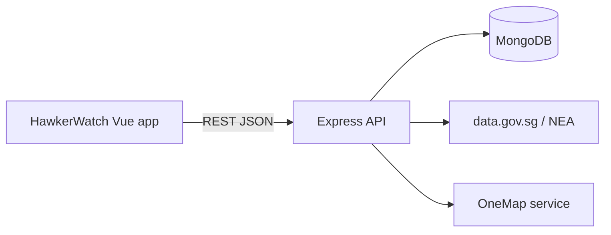

# HawkerWatch

HawkerWatch is a local-development MVP for Singapore diners who want to check a hawker centre before travelling. It combines official NEA closure information with clearly labelled, time-stamped community updates about stalls and queues.

## Stack

- Vue 3, Vite, Vue Router, Bootstrap 5
- Node.js, Express, Mongoose
- MongoDB locally through Docker Compose or MongoDB Atlas
- Vercel for the frontend and Render/Railway for the backend

## Architecture



## Prerequisites

Install Node.js 20+, npm, and either MongoDB or Docker Desktop.

## Local setup

```powershell
npm run install:all
Copy-Item backend/.env.example backend/.env
Copy-Item frontend/.env.example frontend/.env
npm run dev
```

The frontend runs at http://localhost:5173 and the API runs at http://localhost:3000.

Start optional local MongoDB with `docker compose up -d mongodb`. MongoDB is not required by the Phase 1 health endpoint; later phases use `MONGO_URI` from `backend/.env`.

## Commands

- `npm run dev`: run frontend and backend together
- `npm run build`: build the frontend
- `npm test`: run backend tests
- `npm run seed`: seed fictional demo data (Phase 2)
- `npm run import:closures`: import official closure data (Phase 4)

## API starter endpoints

- `GET /api/health`

All responses use `{ success: true, data: ... }` or `{ success: false, message: ... }`.

## Data sources and attribution

Planned official closure data source: [data.gov.sg / NEA](https://data.gov.sg/datasets/d_bda4baa634dd1cc7a6c7cad5f19e2d68/view). Planned location service: [OneMap / Singapore Land Authority](https://www.onemap.gov.sg/apidocs/).

Live stall status and queue estimates are community submitted, time-stamped, may expire, and are not official or guaranteed.

## Deployment notes

Build `frontend` with Vite and deploy it to Vercel. Deploy `backend` to Render or Railway with the environment variables from `backend/.env.example`. Use MongoDB Atlas for hosted persistence. Never commit `.env` files or production credentials.

For the development-only import routes planned in a later phase, configure `ADMIN_IMPORT_KEY` and send it in the documented request header. No production secret is included in this repository.
