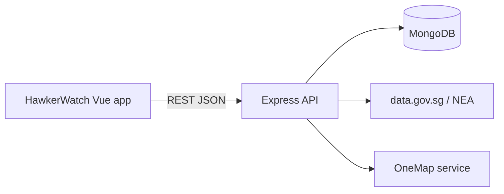

# HawkerWatch

HawkerWatch is a local-development MVP for Singapore diners who want to check a hawker centre before travelling. It combines official NEA closure information with clearly labelled, time-stamped community updates about stalls and queues.

## Stack

- Vue 3, Vite, Vue Router, Bootstrap 5, Axios
- Node.js, Express, Mongoose, Axios (for outside APIs)
- MongoDB Atlas, or MongoDB running locally
- Vercel for the frontend and Render/Railway for the backend

## Architecture



## Progress

| Area | Status |
|---|---|
| Database models, seed data, error handling | Done |
| Hawker-centre and stall API (search, near me, community summary) | Done |
| Authentication (register, log in, log out, current user, change name and password) | Done |
| Account security: password rules with live checklist, show/hide password, Caps Lock warning, failed-login limit, unique emails and names | Done |
| Discovery frontend: home page and centre detail page | Done |
| Favourites: API, page, heart buttons, reminder preferences | Done (reminders are saved but not sent) |
| Profile page | Done |
| Explore Map (OneMap basemap) | Done |
| Community reports: submit from stall cards, 60-minute expiry, 15-minute duplicate rule, rate limit | Done |
| Community report flagging: Flag button in each stall's recent updates; 3 flags hide a report everywhere | Done |
| Interactive API docs at `/api/docs` | Done |
| Official NEA closure import | Placeholder script only |
| OneMap address search | Backend stub only |
| Centre comments: post, edit and delete your own; admins can delete any | Done |
| Deployment (Vercel + Render/Railway) | Not started |

The app is designed for desktop browsers. Layouts also adapt to small screens, but phone support is not tested and is outside the current scope.

## Prerequisites

Install Node.js 22 or newer and npm (CI uses Node 22). You also need a MongoDB database: the team's MongoDB Atlas cluster, or MongoDB running on your own computer.

## Local setup

```powershell
npm run install:all
Copy-Item backend/.env.example backend/.env
npm run dev
```

Then edit `backend/.env`:

- `MONGO_URI`: the team's Atlas connection string, or `mongodb://127.0.0.1:27017` for a local MongoDB.
- `MONGO_DB_NAME`: set your own name, e.g. `hawker-watch-yourname`. `npm run seed` deletes and refills the whole database, so without this you would wipe the shared team data.
- `JWT_SECRET`: any long random text for local development.

The frontend runs at http://localhost:5173 and the API runs at http://localhost:3000. In development Vite forwards `/api` requests to the backend, so the frontend needs no `.env` file. Set `VITE_API_URL` in `frontend/.env` only if the API is hosted somewhere else.

## Commands

- `npm run dev`: run frontend and backend together
- `npm run build`: build the frontend
- `npm test`: run backend tests
- `npm run seed`: replace the database contents with fictional demo data (3 centres, 10 stalls, live and expired reports, and a demo login). **This deletes every account in the database**, including ones you registered, so only run it when you want a fresh start
- `npm run import:closures`: import official closure data (placeholder, Phase 4)

## Trying the frontend

After `npm run seed` and `npm run dev`, open http://localhost:5173.

- **Home page (`/`)**: search finds both hawker centres (by name or address) and stalls (by name). Filter with **Near me** (centres within 2 km of your location; the browser asks for permission), **Open today** (no official closure today), **Has live updates** (a community report in the last 60 minutes), and the **Food options** chips (cuisines). Filters can be combined.
- **Centre page (`/hawker-centres/:id`)**: official NEA closures and the community summary are shown in separate, labelled panels. Below them is the centre's stall list with each stall's live status, a search box, Food options chips, and an expandable list of recent updates with a **Flag** button for wrong reports.
- Clicking a stall in the home page search results opens its centre page and highlights that stall.
- **Explore Map (`/map`)**: every centre on the OneMap basemap, coloured by official closure status. Select a marker or a centre in the side list for details; **Show where I am** sorts the list nearest first.
- **Favourites (`/favourites`, login required)**: the heart on any centre or stall saves it. The page shows saved centres and stalls with their closures, live status and reminder.
- **Profile (`/profile`, login required)**: account details, change name, change password, and reminder days and time for each favourite. Reminders are saved preferences only; nothing is sent yet.

To try favourites, reporting and the profile page, log in as **demo@example.com** / **Hawker#Run1** (set `SEED_DEMO_PASSWORD` in `backend/.env` to change it before seeding). It starts with two favourites and a weekday reminder. The other seeded users can't log in. Accounts you register yourself last until the next `npm run seed`.

With the seed data, Seaside Demo Hawker Centre is officially closed today, Kampong Demo Food Centre has cleaning in 5 days, and Kampong has 3 stalls with live reports.

## Frontend structure

```text
frontend/src/
  views/        HomeView, HawkerCentreView, MapView, FavouritesView, ProfileView, LoginView, RegisterView
  components/   SearchBar, FilterChips, HawkerCentreCard, StallCard, StatusBadge, ClosureBadge,
                OfficialClosureAlert, CommunityUpdateCard, FavouriteButton, FavouriteAlertEditor,
                LoadingState, ErrorState
  services/     apiClient (shared Axios settings and error helper), hawkerService, authService, favouriteService
  stores/       useAuthStore, useFavouriteStore
  utils/        status labels, closure dates, time formatting, location and distance, reminder text
```

## API endpoints

With `npm run dev` running, open **http://localhost:5173/api/docs** for an interactive list of every endpoint (Swagger UI), including request examples, possible responses, a **Try it out** button, and the outside services HawkerWatch uses. The raw OpenAPI description is at `/api/docs.json`. It lives in `backend/docs/openapi.js`; `npm test` fails if a route is added without documenting it there.

| Method | Path | Notes |
|---|---|---|
| GET | `/api/health` | |
| POST | `/api/auth/register` | `{ name, email, password }`; password needs 8 to 72 characters, a capital letter and a special character; sets the login cookie |
| POST | `/api/auth/login` | `{ email, password }`; sets the login cookie. After 10 failed attempts from one IP in 15 minutes, returns 429 until the window ends |
| GET | `/api/auth/me` | Current user; 401 when logged out |
| PATCH | `/api/auth/me` | `{ name }`; login required |
| PATCH | `/api/auth/password` | `{ currentPassword, newPassword }`; login required; same rules as register for the new password |
| POST | `/api/auth/logout` | Clears the login cookie |
| GET | `/api/hawker-centres` | Optional `search`, and `lat` + `lng` + `radius` (metres, default 2000) for nearest first |
| GET | `/api/hawker-centres/:id` | Includes official `closures` |
| GET | `/api/hawker-centres/:id/stalls` | Optional `search`, `cuisine`; each stall has its newest live report as `liveReport` |
| GET | `/api/hawker-centres/:id/community-summary` | Live report counts by status |
| GET | `/api/stalls` | Optional `search`, `cuisine`; includes the stall's centre name and address |
| GET | `/api/stalls/:id` | Includes `liveReport` |
| GET | `/api/stalls/:id/reports` | Live reports, newest first |
| GET | `/api/favourites` | Login required; the user's favourites with the stall or centre filled in |
| POST | `/api/favourites` | `{ targetType: 'Stall' or 'HawkerCentre', target }`; 409 if already saved |
| PATCH | `/api/favourites/:id/alert` | `{ enabled, days: [0-6, 0 = Sunday], time: 'HH:mm' }` |
| DELETE | `/api/favourites/:id` | Removes one of the user's favourites |
| GET | `/api/reports` | `stallId` or `hawkerCentreId`; live community reports |
| POST | `/api/reports` | `{ stallId, status }`; login required; rate limited |
| POST | `/api/reports/:id/flag` | Login required; flags a report |
| GET | `/api/hawker-centres/:id/comments` | Newest first, each with the author's name |
| POST | `/api/hawker-centres/:id/comments` | `{ text }` (1 to 500 characters); login required; rate limited |
| PATCH | `/api/comments/:id` | `{ text }`; login required; author only |
| DELETE | `/api/comments/:id` | Login required; author or admin |

All responses use `{ success: true, data: ... }` or `{ success: false, message: ... }`. Community reports expire 60 minutes after they are made; only live (unexpired) reports are returned.

## Data sources and attribution

Planned official closure data source: [data.gov.sg / NEA](https://data.gov.sg/datasets/d_bda4baa634dd1cc7a6c7cad5f19e2d68/view). Planned location service: [OneMap / Singapore Land Authority](https://www.onemap.gov.sg/apidocs/).

Live stall status and queue estimates are community submitted, time-stamped, may expire, and are not official or guaranteed.

## Deployment notes

Build `frontend` with Vite and deploy it to Vercel. Deploy `backend` to Render or Railway with the environment variables from `backend/.env.example`. Use MongoDB Atlas for hosted persistence. Never commit `.env` files or production credentials.

For the development-only import routes planned in a later phase, configure `ADMIN_IMPORT_KEY` and send it in the documented request header. No production secret is included in this repository.
