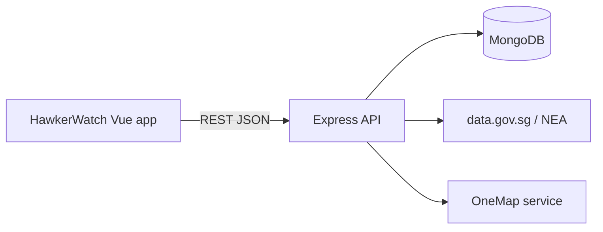

# HawkerWatch

HawkerWatch is a deployed web app for Singapore diners who want to check a hawker centre before travelling. It combines official NEA closure information with clearly labelled, time-stamped community updates about stalls and queues.

Live app: https://hawkerwatch-1ahh.onrender.com · API docs: https://hawkerwatch-api.onrender.com/api/docs (free hosting, so the first load after a quiet spell can take about a minute)

For full setup, testing and deployment instructions (and the test account), see `README.txt`.

## Stack

- Vue 3, Vite, Vue Router, Bootstrap 5, Axios
- Node.js, Express, Mongoose, Axios (for outside APIs)
- MongoDB Atlas, or MongoDB running locally
- Render for the frontend (Static Site) and the backend (Web Service)

## Architecture



## Progress

| Area | Status |
|---|---|
| Database models, seed data, error handling | Done |
| Hawker-centre and stall API (search, near me, community summary) | Done |
| Authentication (register, log in, log out, current user, change name and password) | Done |
| Account security: password rules with live checklist, show/hide password, Caps Lock warning, failed-login limit, unique emails and names | Done |
| Discovery frontend: home page, centre detail page (with a OneMap map of the centre) and stall page | Done |
| Light-theme UI (see `docs/ui-rebuild.md`): design tokens in `frontend/src/style.css`, Bootstrap card grids for centres, stalls and community reports, a stall table with tabs and a map rail on centre pages, queue status as the only colour | Done |
| Live stall count: how many stalls are listed at each centre, on centre cards and the centre page | Done |
| Favourites: API, page, heart buttons, reminder preferences | Done |
| Reminders: the navbar bell lists every favourite whose reminder is due | Done (shown in the app; no email or push) |
| Profile page | Done |
| Explore Map (OneMap basemap) | Done |
| Community reports: submit from stall cards or the Community reports page, 60-minute expiry, 15-minute duplicate rule, rate limit | Done |
| Report location check: must be within 200 m of the centre (browser and backend; `REPORT_LOCATION_CHECK=off` for testing) | Done |
| Distance filters: All / 1 / 5 / 10 km on Explore Map and the home page Near me | Done |
| Community report flagging: Flag button in each stall's recent updates; 3 flags hide a report everywhere | Done |
| Interactive API docs at `/api/docs` | Done |
| Official NEA data: all 123 hawker centres (address, location, photo, stall count) and their closures, imported from data.gov.sg and refreshed weekly | Done |
| Stalls added by users (no official stall list exists); a stall a user adds is hidden until an admin approves it; the person who added a stall or an admin can edit it, admins can remove it | Done |
| Admin page (`/admin`, admins only): approve or reject new stalls, remove and restore stalls, remove community reports (flagged ones first), refresh NEA data, and counts of pending stalls, live and flagged reports and users | Done |
| Stall search results on the home page sorted nearest first (from Near me, a searched place, or the browser's location), with each stall's distance; A to Z on request | Done |
| Stall data: 1437 stalls for all 123 NEA centres from `backend/data/stalls.json` (`pnpm import:stalls`). Real stalls from published food guides for 28 well-known centres; **sample stalls (not real businesses) for the other 95** | Done |
| Cuisine is one of 12 fixed categories (Chinese, Malay, Indian, Peranakan, Western, Japanese, Korean, Thai, Vietnamese, Dessert, Drinks, Others), with the dish in a separate `speciality` field; fixed filter chips | Done |
| Postal code and place search (OneMap, no token needed) on the home page and Explore Map: centres nearest to the place, with the same 1 / 5 / 10 km distances as Near me | Done |
| Centre comments: post, edit and delete your own; admins can delete any | Done |
| Stall reviews: 1 to 5 stars with an optional written review, one per user per stall, counting for 3 months after they are posted or last edited; edit and delete your own; admins can delete any; average shown on stall cards | Done |
| Review photos: up to 4 per review (shrunk in the browser, stored in MongoDB); a self-scrolling slideshow on the stall page links each photo to its review | Done |
| Two-factor login (optional): authenticator-app codes, turned on and off from the Profile page | Done |
| Google login: "Continue with Google" on the Login page and "Sign up with Google" on the Register page; links to an existing account with the same email, or creates one without a password that can set one later on the Profile page | Done |
| Food updates: sold out, some items sold out or quality not great, with an optional note; live until midnight, flaggable | Done |
| Confidence label: how much to trust a stall's community status, from the number and agreement of live reports | Done |
| Automated tests: Vitest unit tests, API tests and Playwright end-to-end tests, all run in GitHub Actions CI (see `README.txt`) | Done |
| Deployment (Render: Static Site + Web Service, MongoDB Atlas) | Done |

## Prerequisites

Install Node.js 22 or newer (CI uses Node 22) and **pnpm**, the package manager this project uses: run `npm install -g pnpm` once. Each `package.json` names the pnpm version (`packageManager`), and pnpm switches to it automatically. You also need a MongoDB database: the team's MongoDB Atlas cluster, or MongoDB running on your own computer.

Use `pnpm` for everything, not `npm`: `pnpm add <package>` (or `pnpm add -D <package>` for dev tools) inside `frontend/` or `backend/`, and commit the updated `pnpm-lock.yaml`. pnpm blocks packages from running install scripts unless they are listed in that folder's `pnpm-workspace.yaml`; if an install stops with "Ignored build scripts", run `pnpm approve-builds <package>` (or `pnpm approve-builds '!<package>'` to refuse) and commit the change.

## Local setup

```powershell
pnpm install:all
Copy-Item backend/.env.example backend/.env
pnpm dev
```

Then edit `backend/.env`:

- `MONGO_URI`: the team's Atlas connection string, or `mongodb://127.0.0.1:27017` for a local MongoDB.
- `MONGO_DB_NAME`: set your own name, e.g. `hawker-watch-yourname`. `pnpm seed` deletes and refills the whole database, so without this you would wipe the shared team data.
- `JWT_SECRET`: any long random text for local development.

The frontend runs at http://localhost:5173 and the API runs at http://localhost:3000. (The class convention is port 8000; the team will switch together later, changing `PORT` in `backend/.env`, `backend/.env.example`, `backend/server.js` and the proxy in `frontend/vite.config.js` at the same time.) In development Vite forwards `/api` requests to the backend, so the frontend needs no `.env` file. Set `VITE_API_URL` in `frontend/.env` only if the API is hosted somewhere else.

## Commands

- `pnpm dev`: run frontend and backend together
- `pnpm build`: build the frontend
- `pnpm test`: run backend tests
- `pnpm test:unit`: run frontend unit tests once (Vitest). Inside `frontend/`, `pnpm test:unit` keeps watching and re-runs tests when files change
- `pnpm lint`: lint the frontend with ESLint
- `pnpm test:e2e`: run the Playwright end-to-end tests (first time: `pnpm --dir frontend exec playwright install chromium`). They only use the `hawker-watch-e2e` database and need `MONGO_URI` and `JWT_SECRET` in `backend/.env`
- `pnpm seed`: replace the database contents with the real NEA centres and closures (needs internet), the stalls in `backend/data/stalls.json`, and demo activity: live and expired reports, 6 reviews with sample food illustrations from `backend/scripts/seed-photos`, favourites, 3 centre comments, a demo login, and a demo login with two-factor login on. The demo activity is only on sample stalls (made-up businesses), mostly at Aljunied Ave 2 Blk 117 and Cheng San Market (Ang Mo Kio Ave 10 Blk 527). **This deletes every account in the database**, including ones you registered, so only run it when you want a fresh start
- `pnpm seed:admin`: create the admin login **admin@hawkerwatch.sg** / **HawkerAdmin#2026** (or make that account an admin again and reset its password). Change it with `ADMIN_EMAIL` and `ADMIN_PASSWORD` in `backend/.env`; always set your own `ADMIN_PASSWORD` for the shared database, as the default is public in this repository: `$env:MONGO_DB_NAME='hawker-watch'; $env:ADMIN_PASSWORD='<a strong password>'; pnpm seed:admin; Remove-Item Env:MONGO_DB_NAME, Env:ADMIN_PASSWORD`
- `pnpm seed:demo`: top up the demo activity before a presentation, **without deleting anything**: fresh live reports and today's food updates on the sample stalls, the 6 sample reviews (skipped if already there), and the two demo logins if they are missing. Reports expire after 60 minutes, so run it within the hour before. To fill the shared database the deployed site uses, in PowerShell: `$env:MONGO_DB_NAME='hawker-watch'; pnpm seed:demo; Remove-Item Env:MONGO_DB_NAME`
- `pnpm import:centres`: import every NEA hawker centre and its closure dates from data.gov.sg. Safe to run any time: centres are updated, never duplicated, and nothing else is deleted. The server also does this by itself on start-up when the data is missing or over a week old (set `HAWKER_IMPORT_ON_START=off` to stop that)
- `pnpm import:stalls`: import the stalls in `backend/data/stalls.json`, matched to centres by NEA serial number (run `pnpm import:centres` first). Safe to run again: stalls are updated, not duplicated, and stalls added by users are left alone. Refuses to run in production, because most of the file is sample data
- `pnpm migrate:cuisines`: one-off fix for databases from before cuisine became a category: moves the old dish name into `speciality` and sets `cuisine` (defaults to Chinese). Run it once if `pnpm seed` would wipe data you want to keep

## Trying the frontend

After `pnpm seed` and `pnpm dev`, open http://localhost:5173.

- **Home page (`/`)**: search finds both hawker centres (by name or address) and stalls (by name). Filter with **Near me** (centres within 1, 5 or 10 km of your location, 5 km by default, nearest first; the browser asks for permission), **Open today** (no official closure today), **Has live updates** (a community report in the last 60 minutes), and the **Cuisine** chips. Filters can be combined.
- **Centre page (`/hawker-centres/:id`)**: official NEA closures and the community summary are shown in separate, labelled panels. Below them is the centre's stall list with each stall's live status, a search box, Cuisine chips, and an expandable list of recent updates with a **Flag** button for wrong reports.
- Clicking a stall in the home page search results opens its centre page and highlights that stall.
- **Explore Map (`/map`)**: every centre on the OneMap basemap, coloured by official closure status. Select a marker or a centre in the side list for details; **Show where I am** sorts the list nearest first, and **Distance from you** (All, 1 km, 5 km, 10 km) shows only centres inside that radius.
- **Community reports (`/reports`)**: the newest live reports across all centres, filterable by status, plus **Report a stall** (choose a centre, a stall and a status). Reports need you to be within 200 m of the centre; your location is only used for that check. For testing or the demo away from a centre, put `REPORT_LOCATION_CHECK=off` in `backend/.env` and the form shows "Location check off (testing)".
- **Favourites (`/favourites`, login required)**: the heart on any centre or stall saves it. The page shows saved centres and stalls with their closures, live status and reminder.
- **Log in / Create account (`/login`, `/register`)**: email and password, or the **Google** button below the form. Google login uses the team's OAuth client ID (built into `frontend/src/utils/googleSignIn.js` and `backend/utils/googleAuth.js`; it is public, not a secret) and only works on the Authorised JavaScript origins set in Google Cloud: `http://localhost:5173`, `http://localhost` and the deployed site.
- **Profile (`/profile`, login required)**: account details, change name, change password (accounts made with Google see **Set a password** instead, with no current password needed), and reminder days and time for each favourite. Due reminders show in the navbar bell while the app is open; no email or push notifications are sent.

To try favourites, reporting and the profile page, log in as **demo@example.com** / **Hawker#Run1** (set `SEED_DEMO_PASSWORD` in `backend/.env` to change it before seeding). It starts with two favourites and a weekday reminder. **demo2fa@example.com** (same password) has two-factor login on: add the key `HAWKERWATCHDEMO2` to an authenticator app to get its codes. The other seeded users can't log in. Accounts you register yourself last until the next `pnpm seed`.

With the seed data, Aljunied Ave 2 Blk 117 has stalls with live reports and reviews with photos (open Hock Lam Chicken Rice for the photo slideshow), and closures come from the real NEA dates.

## Frontend structure

```text
frontend/src/
  views/        HomeView, HawkerCentreView, ExploreMapView, CommunityReportsView, FavouritesView, ProfileView, LoginView, RegisterView
  components/   SearchBar, FilterChips, HawkerCentreCard, StallCard, StatusBadge, ClosureBadge,
                OfficialClosureAlert, FavouriteButton, FavouriteAlertEditor,
                LoadingState, ErrorState
  services/     apiClient (shared Axios settings and error helper), hawkerService, authService, favouriteService, reportService, reviewService, commentService, locationService
  stores/       Pinia setup stores: useAuthStore, useFavouriteStore
  utils/        status labels, closure dates, time formatting, location and distance, reminder text
  **/__tests__/ Vitest tests, next to the code they test (e.g. utils/__tests__/closures.spec.js)
```

Shared state lives in Pinia stores (registered in `main.js`). Read fields straight off the store: `const auth = useAuthStore()`, then `auth.user`, `auth.isLoggedIn`, `auth.isAdmin`; `const favourites = useFavouriteStore()`, then `favourites.items`, `favourites.stalls`, `favourites.toggle('Stall', id)`. Older code used `auth.state.user`; that no longer works.

Import from `src/` with the `@/` alias, e.g. `import { timeAgo } from '@/utils/time.js'`, instead of counting `../` folders. It is set up in `vite.config.js` (and `jsconfig.json` for editor autocomplete); older imports with `../` still work.

Frontend tests use Vitest (`describe` / `it` / `expect`). Put them in a `__tests__` folder beside the file being tested, named `<file>.spec.js`. CI runs them on every push and pull request. Component tests mount a component with Vue Test Utils in a pretend browser page (jsdom); copy `components/__tests__/FilterChips.spec.js` as a starting point. Store tests (`stores/__tests__/useFavouriteStore.spec.js`) replace the service with `vi.mock` so no server is needed.

## API endpoints

With `pnpm dev` running, open **http://localhost:5173/api/docs** for an interactive list of every endpoint (Swagger UI), including request examples, possible responses, a **Try it out** button, and the outside services HawkerWatch uses. The raw OpenAPI description is at `/api/docs.json`. It lives in `backend/docs/openapi.js`; `pnpm test` fails if a route is added without documenting it there.

| Method | Path | Notes |
|---|---|---|
| GET | `/api/health` | |
| POST | `/api/auth/register` | `{ name, email, password }`; password needs 8 to 72 characters, a capital letter and a special character; sets the login cookie |
| POST | `/api/auth/login` | `{ email, password }`; sets the login cookie. After 10 failed attempts from one IP in 15 minutes, returns 429 until the window ends |
| POST | `/api/auth/google` | `{ credential }` (the ID token from Google's button); logs into the account with that Google id or the same verified email, or creates one without a password; sets the login cookie. Accounts with two-factor login get `{ twoFactorRequired, challengeToken }` as with `/login`. Failed attempts count towards the same limit |
| GET | `/api/auth/me` | Current user; 401 when logged out |
| PATCH | `/api/auth/me` | `{ name }`; login required |
| PATCH | `/api/auth/password` | `{ currentPassword, newPassword }`; login required; same rules as register for the new password. Accounts without a password (`hasPassword: false`, made with Google) leave out `currentPassword` to set one |
| POST | `/api/auth/logout` | Clears the login cookie |
| GET | `/api/hawker-centres` | Optional `search`, and `lat` + `lng` + `radius` (metres, default 2000) for nearest first; each centre has `stallCount` (stalls listed now); plus `cuisines` (categories of the listed stalls) and `live` (`{ stallsReported, latestStatus, latestReportAt }` from live reports, or `null`) |
| GET | `/api/hawker-centres/:id` | Includes official `closures` and `stallCount` |
| GET | `/api/hawker-centres/:id/stalls` | Optional `search` (stall name or dish), `cuisine` (exact category); each stall has its newest live report as `liveReport` and its star rating as `rating: { average, count }` |
| POST | `/api/hawker-centres/:id/stalls` | `{ name, cuisine, speciality, unitNumber }` (all but name optional; cuisine is one of the 12 categories, any capitals; speciality is the dish, up to 60 characters; unit like `01-23`); login required; 409 for a name or unit number already used there; rate limited; a stall added by a user has `pendingApproval: true` and is hidden until an admin approves it |
| GET | `/api/hawker-centres/:id/community-summary` | Live report counts by status |
| GET | `/api/hawker-centres/:id/reviews` | The newest current reviews across the centre's stalls (at most 20), each with `stall: { _id, name }`; for the centre page's Reviews tab and photo strip |
| GET | `/api/stalls` | Optional `search` (stall name or dish), `cuisine` (exact category); includes the stall's centre name, address and location, and `rating`; approved stalls only |
| GET | `/api/stalls/:id` | Includes `liveReport`, `rating`, and the centre's location and official closures; 404 once removed |
| PATCH | `/api/stalls/:id` | Any of `{ name, cuisine, speciality, unitNumber }`; login required; the person who added it or an admin |
| DELETE | `/api/stalls/:id` | Admins only; hides the stall (its reviews are kept) |
| GET | `/api/stalls/:id/reports` | Live reports, newest first |
| GET | `/api/favourites` | Login required; the user's favourites with the stall or centre filled in |
| POST | `/api/favourites` | `{ targetType: 'Stall' or 'HawkerCentre', target }`; 409 if already saved |
| PATCH | `/api/favourites/:id/alert` | `{ enabled, days: [0-6, 0 = Sunday], time: 'HH:mm' }` |
| DELETE | `/api/favourites/:id` | Removes one of the user's favourites |
| GET | `/api/reports` | `stallId` or `hawkerCentreId`; live community reports |
| POST | `/api/reports` | `{ stallId, status, lat, lng }`; login required; rate limited; 403 if more than 200 m from the centre |
| GET | `/api/reports/recent` | Newest live reports across all centres; optional `status` |
| GET | `/api/reports/settings` | Whether the location check is on |
| POST | `/api/reports/:id/flag` | Login required; flags a report |
| DELETE | `/api/reports/:id` | Admins only; deletes a report for good |
| GET | `/api/stalls/:id/reviews` | `{ average, count, reviews }`; only reviews from the last 3 months; newest first, each with the author's name |
| POST | `/api/stalls/:id/reviews` | `{ rating: 1-5, text (optional, up to 500 characters) }`; login required; one review per user per stall (409); rate limited |
| PATCH | `/api/reviews/:id` | `{ rating, text }`; login required; author only |
| DELETE | `/api/reviews/:id` | Login required; author or admin; also deletes the review's photos |
| POST | `/api/admin/import-centres` | Admins only; imports the NEA centres and closures now |
| GET | `/api/admin/overview` | Admins only; counts of pending, listed and removed stalls, users, and live and flagged reports |
| GET | `/api/admin/stalls` | Admins only; `status` = `pending` (default), `listed` or `removed`, optional `search`; newest 100, with who added each |
| POST | `/api/admin/stalls/:id/approve` | Admins only; lists a stall waiting for approval |
| POST | `/api/admin/stalls/:id/reject` | Admins only; deletes a stall waiting for approval |
| POST | `/api/admin/stalls/:id/restore` | Admins only; brings back a removed stall with its reviews |
| GET | `/api/admin/reports` | Admins only; newest 100 reports with who sent them and their flag count; `flagged=true` for flagged ones only |
| GET | `/api/geocode?q=289876` | Postal code, address or place search through OneMap; up to 5 places `{ name, address, postalCode, lat, lng }`; rate limited |
| POST | `/api/reviews/:id/photos` | `multipart/form-data` with images in `photos`; JPEG, PNG or WebP, up to 2 MB each, 4 per review; login required; author only; rate limited |
| DELETE | `/api/reviews/:id/photos/:photoId` | Login required; author or admin |
| GET | `/api/review-photos/:id` | The image itself, for `` |
| GET | `/api/hawker-centres/:id/comments` | Newest first, each with the author's name |
| POST | `/api/hawker-centres/:id/comments` | `{ text }` (1 to 500 characters); login required; rate limited |
| PATCH | `/api/comments/:id` | `{ text }`; login required; author only |
| DELETE | `/api/comments/:id` | Login required; author or admin |

All responses use `{ success: true, data: ... }` or `{ success: false, message: ... }`. Community reports expire 60 minutes after they are made; only live (unexpired) reports are returned.

## Data sources and attribution

Official closure data source: [data.gov.sg / NEA](https://data.gov.sg/datasets/d_bda4baa634dd1cc7a6c7cad5f19e2d68/view). Location service: [OneMap / Singapore Land Authority](https://www.onemap.gov.sg/apidocs/).

Live stall status and queue estimates are community submitted, time-stamped, may expire, and are not official or guaranteed.

## Deployment notes

The live app runs on Render: `frontend` as a Static Site and `backend` as a Web Service, with the environment variables from `backend/.env.example` (see `README.txt` for the exact settings). Use MongoDB Atlas for hosted persistence. Never commit `.env` files or production credentials.

Community reports expire after 60 minutes, so before a demo run `pnpm seed:demo` against the shared database (see Commands) to add fresh live reports, food updates and sample reviews without deleting anything.

Official hawker centre data comes from NEA's [Dates of Hawker Centres Closure](https://data.gov.sg/datasets/d_bda4baa634dd1cc7a6c7cad5f19e2d68/view) dataset on data.gov.sg, which needs no API key. Admins can refresh it with `POST /api/admin/import-centres`. No production secret is included in this repository.
